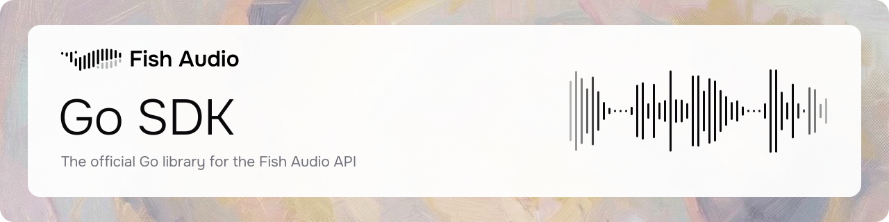

<picture>
  <source media="(prefers-color-scheme: dark)" srcset="https://raw.githubusercontent.com/fishaudio/fish-audio-go/refs/heads/main/.github/assets/banner-dark.svg" />
  
</picture>

# Fish Audio Go SDK

[](https://github.com/fishaudio/fish-audio-go/releases)
[](https://pkg.go.dev/github.com/fishaudio/fish-audio-go)
[](https://goreportcard.com/report/github.com/fishaudio/fish-audio-go)
[](https://codecov.io/gh/fishaudio/fish-audio-go)
[](https://github.com/fishaudio/fish-audio-go/blob/main/LICENSE)

The official Go library for the Fish Audio API

**Documentation:** [Go SDK Guide](https://docs.fish.audio/developer-guide/sdk-guide/go/) | [API Reference](https://docs.fish.audio/api-reference/sdk/go/)

## Installation

```bash
go get github.com/fishaudio/fish-audio-go
```

## Authentication

Get your API key from [fish.audio/app/api-keys](https://fish.audio/app/api-keys):

```bash
export FISH_API_KEY=your_api_key_here
```

Or provide directly:

```go
import fishaudio "github.com/fishaudio/fish-audio-go"

client := fishaudio.NewClient(fishaudio.WithAPIKey("your_api_key"))
```

## Quick Start

```go
package main

import (
	"context"
	"log"
	"os"

	fishaudio "github.com/fishaudio/fish-audio-go"
)

func main() {
	client := fishaudio.NewClient() // reads from FISH_API_KEY
	defer client.Close()

	audio, err := client.TTS.Convert(context.Background(), &fishaudio.ConvertParams{
		Text: "Hello, world!",
	})
	if err != nil {
		log.Fatal(err)
	}

	os.WriteFile("output.mp3", audio, 0644)
}
```

## Core Features

### Text-to-Speech

**With custom voice:**

```go
audio, err := client.TTS.Convert(ctx, &fishaudio.ConvertParams{
	Text:        "Custom voice",
	ReferenceID: "802e3bc2b27e49c2995d23ef70e6ac89",
})
```

**With speed control:**

```go
audio, err := client.TTS.Convert(ctx, &fishaudio.ConvertParams{
	Text:  "Speaking faster!",
	Speed: 1.5, // 1.5x speed
})
```

**Language of the text:**

```go
// "$300" is read as "trescientos pesos" with es-MX, "trescientos dólares" with es
audio, err := client.TTS.Convert(ctx, &fishaudio.ConvertParams{
	Text:     "La entrada cuesta $300.",
	Language: "es-MX",
})
```

`Language` is a BCP-47 tag such as `en`, `es-MX` or `zh-CN`. It only changes how numbers, dates, units and symbols are spelled out before synthesis; it does not change the voice or accent. Leave it empty to let the API detect the language of each chunk, which is also the right choice for text that mixes languages. It is also available on `StreamParams` and `TTSConfig`; on `StreamWebSocket` it applies to the whole session. See [supported normalization languages](https://docs.fish.audio/features/text-to-speech#supported-normalization-languages).

**Choosing a model:**

```go
// Defaults to fishaudio.ModelS21Pro ("s2.1-pro") when Model is not set
audio, err := client.TTS.Convert(ctx, &fishaudio.ConvertParams{
	Text:  "Hello with Drama 3!",
	Model: fishaudio.ModelDrama3,
})
```

Available models: `ModelS21Pro` (default), `ModelS21ProFree`, `ModelDrama3`, `ModelS2Pro` and `ModelS1` (retires 2026-12-31).

**Reusable configuration:**

```go
config := &fishaudio.TTSConfig{
	Prosody:     &fishaudio.Prosody{Speed: 1.2, Volume: -5},
	ReferenceID: "933563129e564b19a115bedd57b7406a",
	Format:      fishaudio.AudioFormatWAV,
	Latency:     fishaudio.LatencyBalanced,
}

// Reuse across generations
audio1, _ := client.TTS.Convert(ctx, &fishaudio.ConvertParams{Text: "First message", Config: config})
audio2, _ := client.TTS.Convert(ctx, &fishaudio.ConvertParams{Text: "Second message", Config: config})
```

**Chunk-by-chunk streaming:**

```go
stream, err := client.TTS.Stream(ctx, &fishaudio.StreamParams{
	Text: "Long content to stream...",
})
if err != nil {
	log.Fatal(err)
}
defer stream.Close()

for stream.Next() {
	chunk := stream.Bytes()
	// process each chunk as it arrives
}
if err := stream.Err(); err != nil {
	log.Fatal(err)
}

// Or collect all chunks at once
stream, _ := client.TTS.Stream(ctx, &fishaudio.StreamParams{Text: "Hello!"})
audio, err := stream.Collect()
```

[Learn more](https://docs.fish.audio/developer-guide/sdk-guide/go/text-to-speech)

### Speech-to-Text

```go
audioData, _ := os.ReadFile("audio.wav")
result, err := client.ASR.Transcribe(ctx, audioData, &fishaudio.TranscribeParams{
	Language: "en",
})
if err != nil {
	log.Fatal(err)
}

fmt.Println(result.Text)

// Access timestamped segments
for _, seg := range result.Segments {
	fmt.Printf("[%.2fs - %.2fs] %s\n", seg.Start, seg.End, seg.Text)
}
```

[Learn more](https://docs.fish.audio/developer-guide/sdk-guide/go/speech-to-text)

### Real-time Streaming

Stream dynamically generated text for conversational AI and live applications:

```go
textChan := make(chan string)

go func() {
	defer close(textChan)
	textChan <- "Hello, "
	textChan <- "this is "
	textChan <- "streaming!"
}()

wsStream, err := client.TTS.StreamWebSocket(ctx, textChan, &fishaudio.StreamParams{
	Latency: fishaudio.LatencyBalanced,
}, nil)
if err != nil {
	log.Fatal(err)
}

for wsStream.Next() {
	chunk := wsStream.Bytes()
	// play or process audio chunk
}
if err := wsStream.Err(); err != nil {
	log.Fatal(err)
}
```

[Learn more](https://docs.fish.audio/developer-guide/sdk-guide/go/websocket)

### Voice Cloning

**Instant cloning:**

```go
refAudio, _ := os.ReadFile("reference.wav")
audio, err := client.TTS.Convert(ctx, &fishaudio.ConvertParams{
	Text: "Cloned voice speaking",
	References: []fishaudio.ReferenceAudio{{
		Audio: refAudio,
		Text:  "Text spoken in reference",
	}},
})
```

**Persistent voice models:**

```go
// Create a voice model for reuse
sample, _ := os.ReadFile("voice_sample.wav")
voice, err := client.Voices.Create(ctx, &fishaudio.CreateVoiceParams{
	Title:       "My Voice",
	Voices:      [][]byte{sample},
	Description: "Custom voice clone",
})
if err != nil {
	log.Fatal(err)
}

// Use the created model
audio, err := client.TTS.Convert(ctx, &fishaudio.ConvertParams{
	Text:        "Using my saved voice",
	ReferenceID: voice.ID,
})
```

[Learn more](https://docs.fish.audio/developer-guide/sdk-guide/go/voice-cloning)

## Resource Clients

| Resource         | Description      | Key Methods                              |
|------------------|------------------|------------------------------------------|
| `client.TTS`     | Text-to-speech   | `Convert()`, `Stream()`, `StreamWebSocket()` |
| `client.ASR`     | Speech recognition | `Transcribe()`                          |
| `client.Voices`  | Voice management | `List()`, `Get()`, `Create()`, `Update()`, `Delete()` |
| `client.Account` | Account info     | `GetCredits()`, `GetPackage()`           |

## Error Handling

```go
import "errors"

audio, err := client.TTS.Convert(ctx, &fishaudio.ConvertParams{Text: "Hello!"})
if err != nil {
	var authErr *fishaudio.AuthenticationError
	var rateLimitErr *fishaudio.RateLimitError
	var validationErr *fishaudio.ValidationError
	var apiErr *fishaudio.APIError

	switch {
	case errors.As(err, &authErr):
		fmt.Println("Invalid API key")
	case errors.As(err, &rateLimitErr):
		fmt.Println("Rate limit exceeded")
	case errors.As(err, &validationErr):
		fmt.Printf("Invalid request: %v\n", validationErr)
	case errors.As(err, &apiErr):
		fmt.Printf("API error: %v\n", apiErr)
	default:
		fmt.Printf("Error: %v\n", err)
	}
}
```

## Resources

- **Documentation:** [Go SDK Guide](https://docs.fish.audio/developer-guide/sdk-guide/go/) | [API Reference](https://docs.fish.audio/api-reference/sdk/go/)
- **Package:** [pkg.go.dev](https://pkg.go.dev/github.com/fishaudio/fish-audio-go) | [GitHub](https://github.com/fishaudio/fish-audio-go)

## License

This project is licensed under the Apache-2.0 License - see the [LICENSE](LICENSE) file for details.
