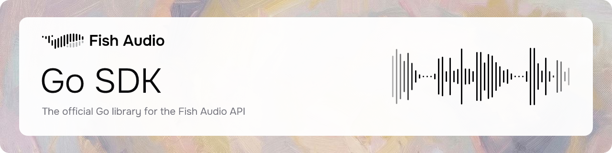

# Fish Audio Go SDK

[](https://github.com/fishaudio/fish-audio-go/releases)
[](https://pkg.go.dev/github.com/fishaudio/fish-audio-go)
[](https://goreportcard.com/report/github.com/fishaudio/fish-audio-go)
[](https://codecov.io/gh/fishaudio/fish-audio-go)
[](https://github.com/fishaudio/fish-audio-go/blob/main/LICENSE)

The official Go library for the Fish Audio API

**Documentation:** [Go SDK Guide](https://docs.fish.audio/developer-guide/sdk-guide/go/) | [API Reference](https://docs.fish.audio/api-reference/sdk/go/)

## Installation

```bash
go get github.com/fishaudio/fish-audio-go
```

## Authentication

Get your API key from [fish.audio/app/api-keys](https://fish.audio/app/api-keys):

```bash
export FISH_API_KEY=your_api_key_here
```

Or provide directly:

```go
import fishaudio "github.com/fishaudio/fish-audio-go"

client := fishaudio.NewClient(fishaudio.WithAPIKey("your_api_key"))
```

## Quick Start

```go
package main

import (
	"context"
	"log"
	"os"

	fishaudio "github.com/fishaudio/fish-audio-go"
)

func main() {
	client := fishaudio.NewClient() // reads from FISH_API_KEY
	defer client.Close()

	audio, err := client.TTS.Convert(context.Background(), &fishaudio.ConvertParams{
		Text: "Hello, world!",
	})
	if err != nil {
		log.Fatal(err)
	}

	os.WriteFile("output.mp3", audio, 0644)
}
```

## Core Features

### Text-to-Speech

**With custom voice:**

```go
audio, err := client.TTS.Convert(ctx, &fishaudio.ConvertParams{
	Text:        "Custom voice",
	ReferenceID: "802e3bc2b27e49c2995d23ef70e6ac89",
})
```

**With speed control:**

```go
audio, err := client.TTS.Convert(ctx, &fishaudio.ConvertParams{
	Text:  "Speaking faster!",
	Speed: 1.5, // 1.5x speed
})
```

**Reusable configuration:**

```go
config := &fishaudio.TTSConfig{
	Prosody:     &fishaudio.Prosody{Speed: 1.2, Volume: -5},
	ReferenceID: "933563129e564b19a115bedd57b7406a",
	Format:      fishaudio.AudioFormatWAV,
	Latency:     fishaudio.LatencyBalanced,
}

// Reuse across generations
audio1, _ := client.TTS.Convert(ctx, &fishaudio.ConvertParams{Text: "First message", Config: config})
audio2, _ := client.TTS.Convert(ctx, &fishaudio.ConvertParams{Text: "Second message", Config: config})
```

**Chunk-by-chunk streaming:**

```go
stream, err := client.TTS.Stream(ctx, &fishaudio.StreamParams{
	Text: "Long content to stream...",
})
if err != nil {
	log.Fatal(err)
}
defer stream.Close()

for stream.Next() {
	chunk := stream.Bytes()
	// process each chunk as it arrives
}
if err := stream.Err(); err != nil {
	log.Fatal(err)
}

// Or collect all chunks at once
stream, _ := client.TTS.Stream(ctx, &fishaudio.StreamParams{Text: "Hello!"})
audio, err := stream.Collect()
```

[Learn more](https://docs.fish.audio/developer-guide/sdk-guide/go/text-to-speech)

### Speech-to-Text

```go
audioData, _ := os.ReadFile("audio.wav")
result, err := client.ASR.Transcribe(ctx, audioData, &fishaudio.TranscribeParams{
	Model:    fishaudio.ASRModelTranscribe1Pro, // optional; recommended
	Language: "en",
})
if err != nil {
	log.Fatal(err)
}

fmt.Println(result.Text)

// Access timestamped segments
for _, seg := range result.Segments {
	fmt.Printf("[%.2fs - %.2fs] %s\n", seg.Start, seg.End, seg.Text)
}
```

`Model` is optional: without it the request runs on the API's default model.

[Learn more](https://docs.fish.audio/developer-guide/sdk-guide/go/speech-to-text)

### Realtime Speech-to-Text

Stream live audio and get the transcript turn by turn with `transcribe-stream-1` (Preview). Send 16-bit little-endian mono PCM on a channel, 20-40 ms per chunk, and read the events the server sends back:

```go
audio := make(chan []byte)

go func() {
	defer close(audio) // no more audio: the server commits the last turn and ends the session
	for chunk := range microphone() { // 16-bit mono PCM, 16 kHz, 40 ms per chunk
		audio <- chunk
	}
}()

stream, err := client.ASR.StreamWebSocket(ctx, audio, &fishaudio.ASRRealtimeParams{
	SampleRate: 16000,
	Results: &fishaudio.ASRResults{
		Drafts:  fishaudio.Bool(true),  // live drafts while a turn is open
		Diarize: fishaudio.Bool(false), // plain text, without speaker tags
	},
}, nil)
if err != nil {
	log.Fatal(err)
}
defer stream.Close()

for stream.Next() {
	switch e := stream.Event().(type) {
	case *fishaudio.ASRDraftEvent: // the turn so far, not final
		fmt.Println("...", e.Text)
	case *fishaudio.ASRCommittedEvent: // the final transcript of the turn
		fmt.Println(e.Text)
	}
}
if err := stream.Err(); err != nil {
	log.Fatal(err)
}
```

**Speaker tags.** By default every transcript starts with a speaker tag, such as `<|speaker:0|> Hello.` Set `Results.Diarize` to `fishaudio.Bool(false)`, as above, for plain text. Optional booleans are pointers so that "not set" (the server default) differs from `false`; `fishaudio.Bool` makes one.

**Events.** Each event is its own type: `ASRSessionStartedEvent`, `ASRSpeechStartEvent`, `ASRUserTurnTakenEvent`, `ASRDraftEvent`, `ASREagerEndOfTurnEvent`, `ASRTurnResumedEvent`, `ASRUserBackchannelEvent`, `ASRCommittedEvent`, `ASRVADEvent`, `ASREOTProbEvent`, `ASRConfiguredEvent`, `ASRProgressEvent`, `ASRErrorEvent` (an error the session survived) and `ASRSessionDoneEvent`. Message types the SDK does not know are skipped.

**Options.** `ASRRealtimeParams` covers the session's settings: `SampleRate` (the server converts it, so do not resample), `TurnDetection` (`auto`, `vad` or `manual` mode, eager end of turn, silence timeout), `Results` (drafts, word timestamps, speaker and sound tags, VAD and end-of-turn events), `Context` (terms to recognize and earlier conversation) and `ClientReferenceID`.

**During the session.** The stream also sends control messages, in order with the audio: `Finalize()` commits the current turn (push-to-talk), `AgentSpeaking(bool)`, `AddContext(...)` and `ReplaceContext(...)` are for voice agents, `Configure(...)` changes settings, and `Keepalive()` keeps an idle session open.

**Ending a session.** Close the audio channel to end normally: the last event is `ASRSessionDoneEvent`. `stream.Close()` or canceling `ctx` ends it at once. If your audio source fails, cancel `ctx` with the error (`context.WithCancelCause`) and `stream.Err()` returns it. The SDK sends a WebSocket ping every 20 seconds, which keeps a session open, and billed, while no audio arrives: close the channel when your source stops, or set `WebSocketOptions.PingInterval` to 0 to let the server close idle sessions.

**Errors.** A refused connection is returned by `StreamWebSocket` as the usual API error (`*AuthenticationError`, `*RateLimitError`, ...), and so is an invalid configuration, as `*ASRRealtimeError`. A session the server ends abnormally makes `stream.Err()` return `*ASRRealtimeError`, with the server's `ErrorType`, `Code`, `RequestID` and the WebSocket `CloseCode`; a lost connection returns `*WebSocketError`.

[Learn more](https://docs.fish.audio/features/speech-to-text/realtime)

### Real-time Streaming

Stream dynamically generated text for conversational AI and live applications:

```go
textChan := make(chan string)

go func() {
	defer close(textChan)
	textChan <- "Hello, "
	textChan <- "this is "
	textChan <- "streaming!"
}()

wsStream, err := client.TTS.StreamWebSocket(ctx, textChan, &fishaudio.StreamParams{
	Latency: fishaudio.LatencyBalanced,
}, nil)
if err != nil {
	log.Fatal(err)
}

for wsStream.Next() {
	chunk := wsStream.Bytes()
	// play or process audio chunk
}
if err := wsStream.Err(); err != nil {
	log.Fatal(err)
}
```

[Learn more](https://docs.fish.audio/developer-guide/sdk-guide/go/websocket)

### Voice Cloning

**Instant cloning:**

```go
refAudio, _ := os.ReadFile("reference.wav")
audio, err := client.TTS.Convert(ctx, &fishaudio.ConvertParams{
	Text: "Cloned voice speaking",
	References: []fishaudio.ReferenceAudio{{
		Audio: refAudio,
		Text:  "Text spoken in reference",
	}},
})
```

**Persistent voice models:**

```go
// Create a voice model for reuse
sample, _ := os.ReadFile("voice_sample.wav")
voice, err := client.Voices.Create(ctx, &fishaudio.CreateVoiceParams{
	Title:       "My Voice",
	Voices:      [][]byte{sample},
	Description: "Custom voice clone",
})
if err != nil {
	log.Fatal(err)
}

// Use the created model
audio, err := client.TTS.Convert(ctx, &fishaudio.ConvertParams{
	Text:        "Using my saved voice",
	ReferenceID: voice.ID,
})
```

[Learn more](https://docs.fish.audio/developer-guide/sdk-guide/go/voice-cloning)

## Resource Clients

| Resource         | Description      | Key Methods                              |
|------------------|------------------|------------------------------------------|
| `client.TTS`     | Text-to-speech   | `Convert()`, `Stream()`, `StreamWebSocket()` |
| `client.ASR`     | Speech recognition | `Transcribe()`, `StreamWebSocket()`      |
| `client.Voices`  | Voice management | `List()`, `Get()`, `Create()`, `Update()`, `Delete()` |
| `client.Account` | Account info     | `GetCredits()`, `GetPackage()`           |

## Error Handling

```go
import "errors"

audio, err := client.TTS.Convert(ctx, &fishaudio.ConvertParams{Text: "Hello!"})
if err != nil {
	var authErr *fishaudio.AuthenticationError
	var rateLimitErr *fishaudio.RateLimitError
	var validationErr *fishaudio.ValidationError
	var apiErr *fishaudio.APIError

	switch {
	case errors.As(err, &authErr):
		fmt.Println("Invalid API key")
	case errors.As(err, &rateLimitErr):
		fmt.Println("Rate limit exceeded")
	case errors.As(err, &validationErr):
		fmt.Printf("Invalid request: %v\n", validationErr)
	case errors.As(err, &apiErr):
		fmt.Printf("API error: %v\n", apiErr)
	default:
		fmt.Printf("Error: %v\n", err)
	}
}
```

## Resources

- **Documentation:** [Go SDK Guide](https://docs.fish.audio/developer-guide/sdk-guide/go/) | [API Reference](https://docs.fish.audio/api-reference/sdk/go/)
- **Package:** [pkg.go.dev](https://pkg.go.dev/github.com/fishaudio/fish-audio-go) | [GitHub](https://github.com/fishaudio/fish-audio-go)

## License

This project is licensed under the Apache-2.0 License - see the [LICENSE](LICENSE) file for details.
